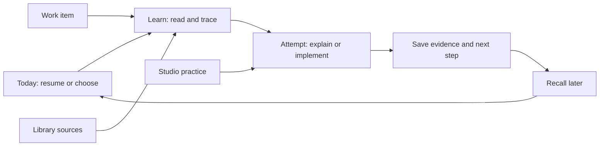

# Kimo personal dashboard plan

2026-10-14. Owner: Benedict. Baseline: 2f4f8cb980fe46de3d25f688e422e753d490005d.
Working branch: docs/personal-dashboard-plan-20261014.

## Outcome

One private dashboard connects daily work, project context, documentation and
deliberate practice. Its first success is helping Benedict understand and retain
what he builds. It should be comfortable on a laptop and useful on a phone.

The core loop is:

## Information architecture

| Area | Primary job | Result |
| --- | --- | --- |
| Today / | Resume learning and choose a small next action | A started session or actionable task |
| Learn /learn | Follow a track, review or practice | Reading progress plus separate practice evidence |
| Work /work | Organize tasks and projects | A clear queue, owner-defined status and next step |
| Library /library | Find and read sources | A source opened at the useful section |
| Studio /studio | Practice design with a brief and critique | Saved rationale and a next iteration |
| Ideas /ideas | Capture and triage | Kept idea, promoted task or archived item |
| Journal /journal | Explain a concept and revisit recall attempts | A dated record of understanding and open questions |
| Connections /connections | Understand connected capabilities | Explicit configured/disconnected state |

Ideas and Connections are secondary navigation. Capture, search and the agent
are cross-cutting actions, not competing primary destinations. Existing notebook
URLs and lab/review/exercise URLs remain valid. Library becomes a dedicated route
as Today takes the root.

## Feature sequencing

### Foundation — current implementation

- Shared responsive application shell and genuine shadcn-vue controls.
- Today built from existing notebook/reading/review data, with an honest empty state.
- A durable local queue for tasks and ideas, including project labels, source
  links, notes, status changes and idea promotion.
- A dated learning journal and immutable exercise-attempt history; the existing
  exercise schedule and last-answer field stay compatible.
- Dedicated Work, Library, Studio and Journal entry points; existing roadmap and labs
  remain reachable.
- Source-aware connection states: GitHub, graph retrieval and AI do not imply
  live integration.
- Light/dark themes, keyboard access, mobile navigation and error feedback.

Done when navigation and local capture/work flows work after refresh, core
reading/review/lab flows still function, and mobile layouts have no page overflow.

### Ticket learning

- Link a work item to document sections and an exact repository revision.
- Start with the problem, trace the flow, ask for a prediction, then offer an
  exercise with progressive hints.
- Save learning sessions, immutable attempts, help used, rubric feedback and
  recall outcomes. Keep the current schedule and last-answer fields compatible.
- Repair SI source mappings and maintain aliases so historical saved URLs survive.
- Tutor modes: explain, guide my attempt, review my explanation; context is visible.

Done when one real ticket can be learned and revisited with source citations,
and reading completion cannot be mistaken for independent understanding.

### Work and documentation integration

- Import GitHub issues, PRs, commits and reviews read-only first.
- Keep Jira state, GitHub state, personal task state and agent activity separate.
- Use provider IDs and event IDs for deduplication; show last successful sync,
  retry failure and unknown status.
- Generate a daily draft from evidence; save to each source's established workflow.
  SI worklog entries continue exclusively through si-worklog.
- Link projects, milestones and blockers; generate a resume note from the last
  confirmed session state.

Done when a source change appears once, has an origin link, and stale/conflicting
evidence is visible. No auto-merge, deployment or external comment posting.

### Search and knowledge relationships

- Inventory and fix current references before indexing.
- Index sections with canonical source ID, repo/revision, path, heading,
  content hash, indexed timestamp and access scope.
- Start with text search and explicit ticket/wiki/PR links. Add vector retrieval
  and reranking after measuring questions from actual work.
- Graph edges distinguish source-defined relationships from AI suggestions.
  Graphify is an optional source of code relationships after freshness is checked.
- Bound graph expansion and retrieval tokens; cite the exact source section.
- Reconcile changed/deleted files; invalidate old chunks and detect moved paths.
- Evaluate source correctness, missing evidence, latency and model cost.

SQLite remains the state store initially. PostgreSQL/pgvector is a candidate
index service when justified; migration is not required for the dashboard UI.

### Broader practice

Use a primary language track over several weeks with a daily concept. Connect
coding problem patterns, API/system-design interview questions and existing labs
to that track. Store external problem links and the person's attempt rather than
copying a third-party problem catalogue. Studio follows brief → reference
analysis → own attempt → critique → iteration, using Atelier artifacts.

## Data ownership

| Data | Authority |
| --- | --- |
| SI/project documents | Existing repositories; indexed, read in place |
| Curriculum and authored exercises | Knowledge library |
| Personal tasks, ideas, design notes | KB state database |
| Reading and review state | Existing KB tables |
| Learning attempts | Append-only evidence, linked to source revision |
| PR and issue status | Provider record, cached with timestamp |
| Embeddings/summaries/graph suggestions | Rebuildable derivatives |
| Factual decisions | Explicitly saved source-backed records |

Proposed shared entities: Project, WorkItem, SourceDocument, SourceRevision,
Concept, LearningSession, Attempt, ReviewSchedule, DesignPractice and SyncEvent.
Do not overload WorkItem.status to represent mastery or upstream delivery.

## Code direction

Keep Nuxt/Vue. Add Tailwind v4 through its Vite plugin; preserve the existing
PHP/WASM plugin and Content remark plugins. shadcn-vue source components live
under app/components/ui and use a shared cn helper. Use Ui-prefixed auto imports
or explicit imports to avoid collisions with Nuxt Content and existing components.

Application concerns stay separate: shell navigation, dashboard aggregate
reads, local work-item service, notebook reader and review tools. Derive Today
from the actual records; do not seed fictional activity or mastery metrics.
New API writes validate fields, bounds and status enums. Persist first, then
refresh; keep form values on failure.

## Access from anywhere and NUC hosting

The agreed host is the SI Windows NUC. Historical worklogs record WSL/Docker
and a 6 GB / 4 CPU WSL cap; available resources and current topology need a
deployment check. Start with a private Tailscale URL usable by Benedict's
authorized laptop and phone. “Anywhere” still needs internet, tailnet access
and the NUC online. A disconnected page must not pretend writes were saved.

Plan a loopback-bound app behind Tailscale Serve HTTPS, using the Tailscale node
that can actually reach the app. Verify Windows/WSL forwarding explicitly;
do not assume the two network namespaces share loopback.
Use a dedicated persistent state volume, read-only content mounts and a
configurable library root. Back up SQLite with its backup API (or a stopped,
consistent snapshot including WAL), test restore, and retain content Git history.
Use restart policies and resumable ingestion jobs. Account for Windows updates
and existing browser/automation workloads. Deployment needs an actual phone
test over cellular and an application restart test.

Do not enable Tailscale Funnel or a public unauthenticated host. Browser caching
of private content and offline writes are deferred until their behavior is designed.

## Claude / ChatGPT

The core should expose source-aware tools independently of model choice.
An in-app tutor can call a selected provider API; an MCP server can let existing
assistants use the same records. Persist learning results explicitly through
tools rather than assuming an external conversation synchronizes automatically.
Keep credentials server-side and report usage, cancellation and recoverable errors.

The first integration is now an OpenAI Responses API study companion. It sends
only one selected document from the personal CS notebook by default, plus the
learner's question. The server validates the source against the library root
and explicit notebook IDs, caps context at 12,000 characters, keeps the key
server-side and sets `store: false`. SI and external-reference notebooks are
blocked. No key is provisioned in the repository, so live calls require a
server-side API key. Expansion to other personal tracks needs a content review;
SI cloud sharing was not authorized.

## Verification

Check existing tests and production build. Exercise task creation, editing,
idea promotion and status persistence against an isolated DB. Check API invalid
input and URL handling. Browser-check Today, Learn, Work, Library, Studio,
search and capture at desktop and mobile widths, both themes; include keyboard
dialog close/focus, long titles, no results, unavailable sources and failed saves.
A worktree preview must use a separate state DB from the canonical app.

## Decisions and sources

- 2026-10-14: learning first; existing kb/knowledge; SI Windows NUC.
- 2026-10-14: personal dashboard accessible anywhere, clean responsive shadcn UI,
  flows per feature, documentation requested.
- 2026-10-14: “lets just build it directly” overrides the proposed Figma approval
  workflow. No Figma file is required and no destination was selected.
- 2026-10-14: OpenAI API first, personal KB only. The default allowlist is CS
  Fundamentals; no SI source text is sent to OpenAI.
- 2026-10-14: NUC deployment paused at Benedict's request while local features
  are reviewed. AI-generated plain-language guides are now saved in a reading
  queue with an explicit, reversible read status. See
  [feature review](feature-review.md).
- Existing sources: README.md, app/pages/learn.vue, server/utils/db.ts,
  server/api/search.get.ts, Knowledge roadmap.yaml and si.kb.json.
- [shadcn-vue / Nuxt](https://www.shadcn-vue.com/docs/installation/nuxt)
- [shadcn-vue / Sidebar](https://www.shadcn-vue.com/docs/components/sidebar)
- [Tailscale Serve](https://tailscale.com/docs/reference/tailscale-cli/serve)
- [ChatGPT custom MCP](https://developers.openai.com/api/docs/guides/custom-mcp-server)
- [Claude remote connectors](https://support.claude.com/en/articles/11175166-get-started-with-custom-connectors-using-remote-mcp)
